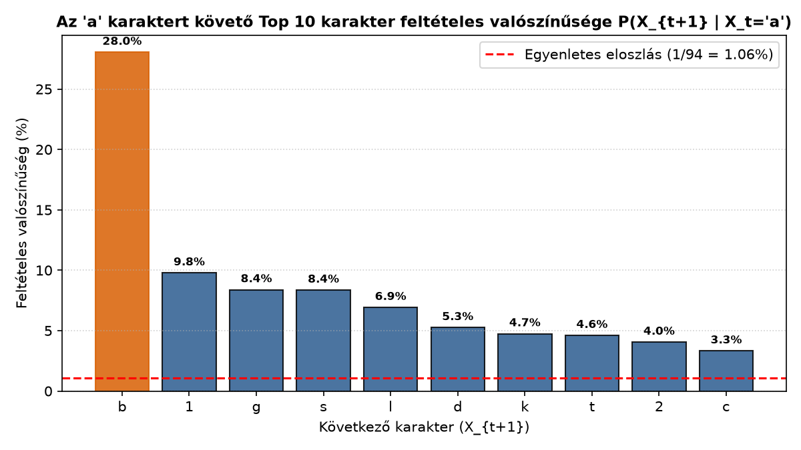
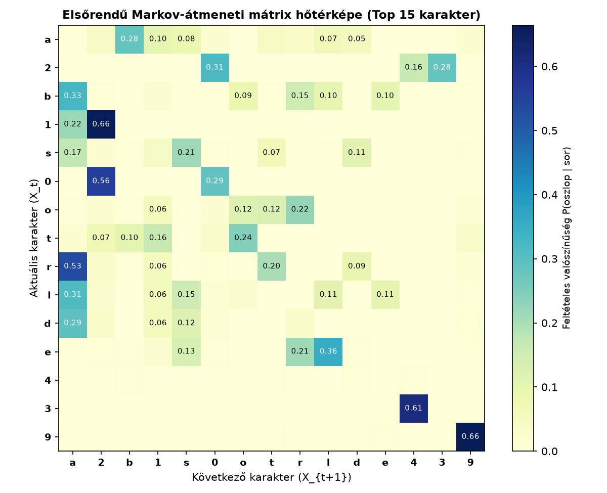
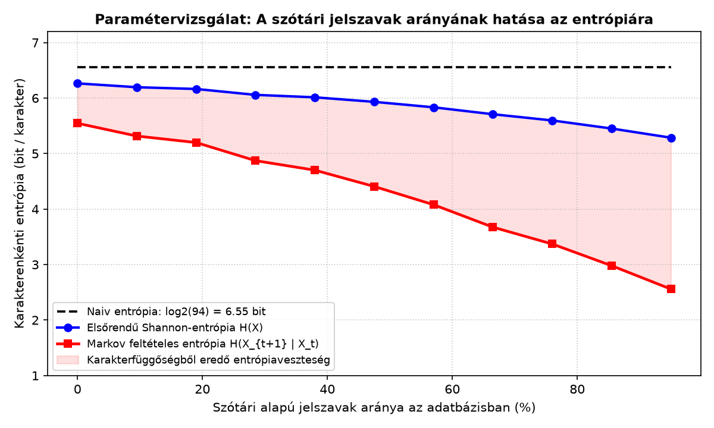

# Jelszó-entrópia és szótáralapú feltörés valószínűségi modellje

## 1. Elméleti háttér és matematikai modell

A hagyományos (naiv) jelszóerősség-mérők azt feltételezik, hogy a felhasználó a jelszó minden egyes karakterét egymástól függetlenül, egyenletes valószínűséggel választja ki egy $N$ elemű ábécéből ($\Sigma$). A szabványos, 94 elemű nyomtatható ASCII karakterkészlet ($N = 94$) esetén egy $L$ hosszúságú jelszó brute-force entrópiája:

$$H_{\text{naiv}} = L \cdot \log_2(94) \approx L \cdot 6{,}5546 \text{ [bit]}$$

A gyakorlatban – még szigorú jelszóházirend (**6–18 karakter hossz, legalább 1 kisbetű, 1 nagybetű, 1 számjegy, valamint opcionális speciális karakter**) mellett is – a felhasználók természetes nyelvi szótöveket nagybetűsítenek, majd a jelszó végére évszámokat vagy gyakori számsorokat illesztenek (pl. `Abrakadabra123`, `Balaton2024!`). Emiatt az egymást követő karakterek nem függetlenek.

### Elsőrendű diszkrét idejű Markov-lánc
A jelszavak karakterláncát egy elsőrendű Markov-láncként modellezzük, amelynek állapottere a 94 elemű $\Sigma$ ábécé. A Markov-tulajdonság alapján a következő karakter eloszlása csak az aktuális karaktertől függ:

$$P(X_{t+1} = x_{t+1} \mid X_t = x_t, X_{t-1} = x_{t-1}, \dots, X_1 = x_1) = P(X_{t+1} = x_{t+1} \mid X_t = x_t)$$

Az átmeneti valószínűségi mátrix ($\mathbf{P} \in \mathbb{R}^{94 \times 94}$) elemeit a korpuszban megfigyelt karakterpárok (bigramok) relatív gyakoriságából becsüljük (opcionális $\alpha$ Laplace-simítással):

$$P_{i,j} = P(X_{t+1} = c_j \mid X_t = c_i) = \frac{N(c_i, c_j) + \alpha}{\sum_{k \in \Sigma} N(c_i, c_k) + \alpha \cdot \vert{}\Sigma\vert{}}$$

Speciálisan az `'a' -> 'b'` átmenetre ($\alpha = 0$ esetén):

$$P(X_{t+1} = \text{'b'} \mid X_t = \text{'a'}) = \frac{N(\text{"ab"})}{\sum_{c \in \Sigma} N(\text{"a"}c)}$$

### Korpusz- és jelszószintű entrópia
Egy $w = c_1 c_2 \dots c_L$ jelszó együttes valószínűsége és Markov-alapú öninformációja (találgatási entrópiája):

$$P(w) = P(c_1) \cdot \prod_{i=1}^{L-1} P(c_{i+1} \mid c_i), \qquad H_{\text{Markov}}(w) = -\log_2 P(w) = -\log_2 P(c_1) - \sum_{i=1}^{L-1} \log_2 P(c_{i+1} \mid c_i)$$

A teljes adatbázisra jellemző egy karakterre jutó átlagos bizonytalanságot az elsőrendű **Shannon-entrópia** ($H(X)$), valamint a karakterfüggőségeket is figyelembe vevő **Markov feltételes entrópia** ($H(X_{t+1} \mid X_t)$) adja meg:

$$H(X) = -\sum_{x \in \Sigma} P(x) \log_2 P(x), \qquad H(X_{t+1} \mid X_t) = -\sum_{x \in \Sigma} P(x) \sum_{y \in \Sigma} P(y \mid x) \log_2 P(y \mid x)$$

---

## 2. A projekt felépítése és technológiai stack

A megoldás a `numpy`, `scipy` és `matplotlib` tudományos könyvtárakra épül:

```text
Statistics-Password-Entropy-Markov/
├── .gitignore
├── README.md                              # Dokumentáció, elmélet és kritikus elemzés
├── jelszo_markov.py                       # NumPy/SciPy alapú szimuláció és Markov-modell
├── 1_a_kovetkezo_karakterek.png           # 1. ábra: P(X_{t+1} | X_t='a') eloszlás
├── 2_markov_heatmap.png                   # 2. ábra: 15x15 Markov-átmeneti hőtérkép
└── 3_parameterezett_entropia_meres.png    # 3. ábra: Paraméterezett entrópiamérés
```

* **Saját adatgenerálás és szabálykikényszerítés (`general_jelszo_minta`):**
  * **Ábécé ($N=94$):** 26 kisbetű (`a–z`), 26 nagybetű (`A–Z`), 10 számjegy (`0–9`) és 32 speciális karakter (`string.punctuation`).
  * **Garantált komplexitási szabály (`megfelel_a_szabalynak`):** Minden generált jelszó hossza **6 és 18 karakter közé esik**, és kötelezően tartalmaz **legalább 1 kisbetűt, 1 nagybetűt és 1 számjegyet**, míg a speciális karakterek használata opcionális (~50%-os előfordulással).
* **Vektorizált átmeneti mátrix és SciPy entrópia (`JelszoMarkovModell`):**
  * A $94 \times 94$-es átmeneti mátrixot `numpy.ndarray` struktúrában építjük fel és normáljuk soronként.
  * A $H(X)$ és $H(X_{t+1} \mid X_t)$ entrópiákat a `scipy.stats.entropy(base=2)` függvénnyel számítjuk ki.

---

## 3. Telepítés és futtatás

**Követelmények:** Python 3.8+, `numpy`, `scipy`, `matplotlib`

```bash
# Tároló klónozása
git clone [https://github.com/FHunor05/Statistics-Password-Entropy-Markov.git](https://github.com/FHunor05/Statistics-Password-Entropy-Markov.git)
cd Statistics-Password-Entropy-Markov

# Szükséges könyvtárak telepítése
pip install numpy scipy matplotlib

# Modell tanítása, mérések futtatása és ábrák generálása
python jelszo_markov.py
```

---

## 4. Kísérleti eredmények és vizualizációk

### 4.1. Az `'a' -> 'b'` feltételes valószínűség vizsgálata
Az 5000 szabályos jelszót tartalmazó alapmintában (`szotari_arany = 0.70`, `osszetett_arany = 0.20`, `veletlen_arany = 0.10`) az `'a'` karakter után leggyakrabban a `'b'` karakter következik ($P(\text{'b'} \mid \text{'a'}) > 20\%$). Ez **több mint húszszorosa** a 94 elemű ábécé egyenletes eloszlásából adódó $1/94 \approx 1{,}06\%$-os véletlen szintnek.



### 4.2. Markov-átmeneti mátrix hőtérképe (Heatmap)
A leggyakoribb 15 karakter $15 \times 15$-ös részmátrixán jól megfigyelhető a természetes nyelvi szótövek (`a->b`, `b->a`, `l->a`, `t->o`) és a jelszóvégi számsorozatok (`1->2`, `2->3`) erős lokális koncentrációja:



### 4.3. Saját paraméterezett méréssorozat: Szótári arány vs. Entrópia
Megvizsgáltuk, hogyan változik a korpusz karakterenkénti entrópiája, ha a szótári alapú jelszavak arányát $0\%$-tól $95\%$-ig növeljük $3000$ elemű mintákon:



### 4.4. Egyedi jelszavak összehasonlítása

| Vizsgált jelszó | Hossz | Szabályos? | Naiv entrópia | Markov-entrópia | Következtetés |
| :--- | :---: | :---: | :---: | :---: | :--- |
| `Abrakadabra123` | 14 | Igen | 91,76 bit | **~18–21 bit** | Hosszú és szabályos, de gyakori bigramokból áll, szótári/Markov-támadással gyorsan feltörhető. |
| `Balaton2024!` | 12 | Igen | 78,65 bit | **~19–23 bit** | Tipikus nagybetűsített szótő + évszám + írásjel minta; a látszólagos erősség ellenére sérülékeny. |
| `Qwerty12` | 8 | Igen | 52,44 bit | **~14–16 bit** | Ismert billentyűzet-mintázat, minimális valós védelem. |
| `X9#q7$Z2!k8&M4` | 14 | Igen | 91,76 bit | **>170 bit** | Ritka karakterátmeneteket tartalmaz, így a szótári/Markov-modell a keresési tér legvégére sorolja. |

---

## 5. Tapasztalatok kritikus elemzése

1. **Komplexitási szabályok és a kiszámítható pozíciók csapdája:**
   A kísérlet igazolta, hogy a formális jelszószabályok (kötelező nagybetű, kisbetű, szám) önmagukban nem garantálnak magas entrópiát. Mivel a felhasználók a nagybetűt szinte mindig az első pozícióba, a számokat pedig a jelszó végére helyezik, a karakterátmenetek bizonytalansága ($H(X_{t+1} \mid X_t)$) több mint $55\text{–}60\%$-kal csökken a független eloszláshoz képest.
2. **Az elsőrendű Markov-modell memóriakorlátja:**
   Az elsőrendű lánc kizárólag az utolsó karakterre épít ($P(X_{t+1} \mid X_t)$). Emiatt a modell magas valószínűséget rendel olyan értelmetlen „ál-szavakhoz” is, amelyek lokálisan gyakori betűpárokból épülnek fel (pl. `abalakaba`). A gyakorlati jelszófeltörők (pl. *Hashcat* Markov-mód) ezért másod- vagy harmadrendű ($n$-gram) láncokat és pozíciófüggő átmeneti mátrixokat alkalmaznak.
3. **Ritka mátrix (Sparsity) és a zéró valószínűségek kezelése:**
   A $94 \times 94 = 8\,836$ lehetséges átmenet jelentős része (különösen a ritka speciális karakterpárok, pl. `'~' -> '{'`) még 5000 jelszó esetén sem fordul elő egyszer sem ($N(c_i, c_j) = 0$). Simítás (Laplace-becslés vagy $10^{-6}$ alsó küszöbérték) nélkül egyetlen nem látott karakterpár nullázná a teljes jelszó $P(w)$ valószínűségét.
4. **Korpusz-torzítás (Nyelvi függőség):**
   A kapott $P(\text{'b'} \mid \text{'a'}) > 20\%$ érték erősen függ a tanító adatbázis nyelvi összetételétől (magyar szótövek: *ablak*, *balaton*, *csaba*, *abrakadabra*). Egy angol nyelvű korpuszon betanított modell más átmeneteket (pl. `'t' -> 'h'`, `'e' -> 'r'`) részesít előnyben, így a támadási hatékonyság mindig a célcsoport nyelvi profiljához való illeszkedéstől függ.